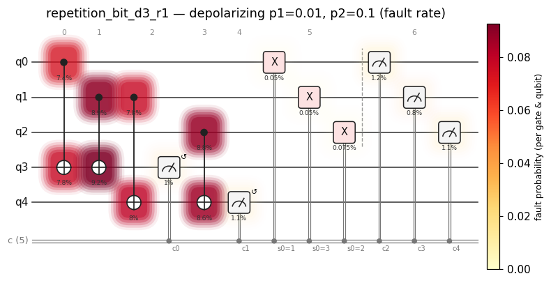

# NoisiQ

**See where errors happen in a quantum circuit — and how they spread.**

[](https://github.com/dtsaxum-oss/NoisiQ/actions/workflows/ci.yml)
[](https://www.python.org/downloads/)
[](LICENSE)

NoisiQ is an open-source Python library for **noise-aware simulation and visualization of
quantum circuits**. Build (or import) any circuit, attach a noise model — from simple Pauli
channels to T1/T2 decoherence, coherent over-rotations, readout errors and real-device
profiles — then *look* at the result:

* **Error heatmaps** — which gates and idle periods contribute the most error, measured from simulation.
* **Propagation animations** — follow a Pauli error layer by layer as gates copy and transform it.
* **Error budgets, outcome comparisons, Bloch spheres** — quantitative summaries with uncertainties.

It is designed first as a **teaching tool** and second as a lightweight **research aid**.
Clifford circuits with Pauli noise run on a fast vectorized stabilizer engine (hundreds of
qubits); everything else runs on a universal trajectory simulator; an exact density-matrix
engine (and optionally Qiskit Aer) is available to cross-check results.

<p align="center">
  
</p>

## Installation

```bash
pip install noisiq                 # core: numpy, matplotlib, stim
pip install "noisiq[widgets]"      # + Jupyter sliders
pip install "noisiq[qiskit]"       # + Qiskit import/export and the Aer backend
```

From source (for development):

```bash
git clone https://github.com/dtsaxum-oss/NoisiQ.git
cd NoisiQ
python -m venv .venv && source .venv/bin/activate   # Windows: .venv\Scripts\activate
pip install -e ".[dev]"
pytest
```

## Quickstart

```python
import noisiq as nq

# 1. Any circuit: fluent builder, ready-made algorithms, or OpenQASM / Qiskit import
circuit = nq.Circuit(3, name="GHZ").h(0).cx(0, 1).cx(1, 2).measure_all()

# 2. A noise model built from rules (or nq.get_hardware("ibm_heron_r3").noise_model())
noise = nq.NoiseModel.uniform_depolarizing(p1=0.002, p2=0.02, readout=0.01)

# 3. Simulate — the backend is chosen automatically
result = nq.simulate(circuit, noise, shots=5000, seed=1, trace_shots=20)
print(result.summary())

# 4. Look at it
nq.plot_error_heatmap(result)  # where errors happen
nq.plot_error_budget(result)  # ranked sources with % share
anim = nq.animate_propagation(result.trace)  # how they spread
nq.save_animation(anim, "ghz.gif")

# 5. The math behind any channel or metric
nq.explain("thermal_relaxation")
```

Inject an error by hand and watch it move (exact, for any Clifford circuit):

```python
trace = nq.propagate(nq.algorithms.ghz(4), "X", qubit=0, after=0)
trace.pauli_strings()  # ['IIII', 'XIII', 'XXII', 'XXXI', 'XXXX']
nq.plot_propagation(trace)
```

## What's inside

| Module | Contents |
|---|---|
| `noisiq.ir` | `Circuit`, gate library (Pauli, Clifford, T, rotations, U, controlled gates, Toffoli, custom unitaries), X/Y/Z measurements, reset, delay, barriers, classical feed-forward |
| `noisiq.noise` | Pauli / depolarizing / bit- & phase-flip, amplitude & phase damping, thermal relaxation (T1+T2), coherent rotations, general Kraus, readout error, quasi-static detuning; rule-based `NoiseModel`; hardware profiles (IBM, IonQ, Quantinuum) |
| `noisiq.backends` | `simulate()`; `frame` (vectorized Pauli frames, any size), `statevector` (universal, ≤26 qubits), `density_matrix` (exact, ≤10 qubits), `aer` (optional) |
| `noisiq.analysis` | exact error propagation (`propagate`), fault spread |
| `noisiq.visualization` | circuit drawer, heatmaps, propagation plots/animations, error budget, counts, comparisons, density matrices, Bloch spheres |
| `noisiq.algorithms` | Bell, GHZ, Deutsch–Jozsa, Bernstein–Vazirani, QFT, Grover, phase estimation, repetition codes, teleportation |
| `noisiq.suppression` | dynamical decoupling (X2/CPMG, XY4, XY8) |
| `noisiq.io` | OpenQASM 2 import/export, Qiskit adapters |

## Documentation

* [Getting started](docs/getting-started.md) — a guided tour
* [Concepts](docs/concepts.md) — conventions (qubit order, layers, bitstrings) and how the pieces fit
* [Noise & metrics math](docs/math.md) — every channel and metric, generated from the code (`nq.explain(...)`)
* [Backends](docs/backends.md) — which engine runs what, and how fast
* [Visualization](docs/visualization.md) — every plot, what it shows and how to read it
* [Maintainer guide](docs/maintainers.md) — architecture, design decisions, how to extend and release
* [Examples](examples/) — runnable scripts and a notebook tour

## Verification

Correctness is checked by an extensive test suite (`pytest`, ~430 tests) including:
exact Clifford conjugation against Stim; every channel CPTP with closed-form T1/T2 decay;
statistical agreement between the frame, statevector, exact density-matrix and Qiskit Aer
engines on random circuits with mid-circuit measurement, resets and feed-forward;
textbook outcomes for every built-in algorithm; and fuzzing of every plot on random circuits.

## Contributing

Contributions are welcome — see [CONTRIBUTING.md](CONTRIBUTING.md) and the
[maintainer guide](docs/maintainers.md).

## Authors

David Saxum, Teddy Jones ([@TeddyJ0nes](https://github.com/TeddyJ0nes)), Giovanni Castorina.
Faculty sponsors: Prof. Niknam, Prof. Ross. Started in the QNT SCI 412 lab course
(MQST program, UCLA), Spring 2026.

## Citation

```bibtex
@software{noisiq2026,
  author  = {Saxum, David and Jones, Teddy and Castorina, Giovanni},
  title   = {NoisiQ: Noise-Aware Quantum Circuit Simulation and Visualization},
  year    = {2026},
  url     = {https://github.com/dtsaxum-oss/NoisiQ},
  version = {0.2.0}
}
```

## License

MIT — see [LICENSE](LICENSE).
